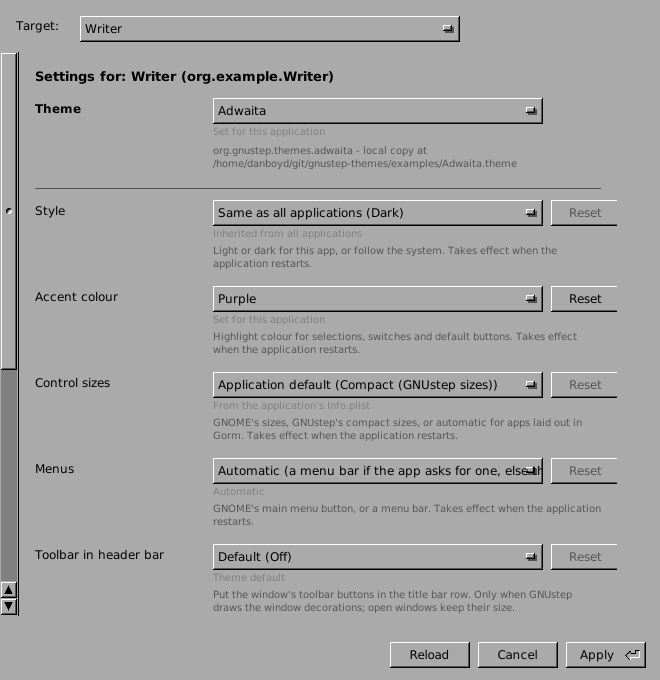

# gnustep-themes: theme settings for GNUstep

A small framework that lets users change a GNUstep theme's settings (light
or dark, accent colour, menu style, control sizes and so on) for all
applications or for one application, without editing defaults by hand.

* **Themes describe their settings** in a static `ThemeSettings.plist`
  inside the theme bundle (schema v1). Tools read that file by path and
  **never load theme code**.
* **GNUstep defaults stay the source of truth.** The editor writes the same
  keys the theme already reads, in `NSGlobalDomain` (all applications) or in
  the application's own domain. There is no separate settings store.
* **The same editor everywhere**: a standalone app, and a view that any
  application can embed as its own theme preferences pane.



## What's here

| Path | What it is |
|---|---|
| `ThemeSettingsKit/` | Foundation-only library: schema loader and validator, theme discovery, exact-domain defaults store, value resolver, edit session (Apply/Cancel with conflict detection). |
| `ThemeSettingsUI/` | AppKit library: `GTSThemeSettingsEditor`, the embeddable editor view. |
| `ThemeSettingsApp/` | Standalone editor, for all applications or a chosen one. |
| `ThemeSettingsDemo/` | An example app that embeds the editor as its own preferences pane. |
| `Tools/ValidateSchema/` | `gts-validate-schema`, a checker for theme authors and CI. |
| `examples/` | `ThemeSettings.plist` for Adwaita, WinUITheme and Gumdrop (mirrors of, or drafts for, the theme owners' files). |
| `docs/` | [User guide](docs/user-guide.md), [end-to-end checks with real themes](docs/end-to-end.md), schema spec, embedding guide, platform notes, Windows audit, [first-release checklist (draft)](docs/release-checklist.md). |

## For theme authors

Add `Resources/ThemeSettings.plist` to your `.theme` bundle. A minimal
example with one setting:

```
{
  SchemaVersion = 1;
  Theme = MyTheme;                       /* the GSTheme value that selects it */
  ThemeIdentifier = "org.example.themes.mytheme";
  Settings = (
    {
      Identifier = "mytheme.accent";
      Key = MyThemeAccentColor;          /* the defaults key your theme reads */
      Type = enum;
      Values = ( { Value = blue; Title = "Blue"; }, { Value = green; Title = "Green"; } );
      Scopes = ( global, application );
      Title = "Accent colour";
      Unset = { Behavior = static; Value = blue; };
      Apply = restart;                   /* or live, newWindows */
    }
  );
}
```

Types are `bool`, `enum`, `number` (with optional `Minimum`/`Maximum`) and
`string`. `Unset` says what the theme does when the key is not set: a fixed
value (`static`) or something it works out at run time (`dynamic`, with
`Help`). `Precedence` describes where the theme looks for the key (command
line, application domain, global domain, the app's Info.plist). The full
rules, each tied to the code that enforces it, are in
[docs/schema-v1.md](docs/schema-v1.md).

Check your file before shipping it:

```sh
scripts/validate-theme.sh path/to/MyTheme.theme     # or the .plist itself
```

Exit status 0 means no errors (warnings are allowed), 1 means at least one
error, and 2 means a usage or build problem. An error means an editor would
skip the setting or reject the file, so it is safe to use in CI. A
ready-made GitHub Actions job for theme repos is in [docs/theme-ci.md](docs/theme-ci.md).

## Building (Linux)

You need gnustep-make, gnustep-base and gnustep-gui development packages,
plus GnuTLS headers and pkg-config (GnuTLS is only used to verify AppImage
sidecar files). On Debian 13:

```sh
sudo apt install gnustep-make libgnustep-base-dev libgnustep-gui-dev \
  gnustep-base-runtime libgnutls28-dev pkg-config
. "$(gnustep-config --variable=GNUSTEP_MAKEFILES)/GNUstep.sh"
make                                   # libThemeSettingsKit + libThemeSettingsUI
make -C ThemeSettingsApp && openapp ./ThemeSettingsApp/ThemeSettings.app
```

Unit tests use XCTest from
[gnustep/tools-xctest](https://github.com/gnustep/tools-xctest).
`scripts/ci.sh` builds a pinned copy into a private directory and runs
everything CI runs:

```sh
scripts/ci.sh            # build, 129 unit tests, new-user check, schema validator
```

Tests never touch your real defaults: each run uses a scratch defaults root
and checks that it did. gnustep-base ignores `HOME`, so the runners also set
`GNUSTEP_HOME` inside the scratch root and refuse to run if a gnustep-base
that honours it resolves elsewhere. (Debian's 1.31.1 ignores `GNUSTEP_HOME`
too; there every user path is set absolute in a private config instead.) `scripts/screenshots.sh` drives the real GUI on a
private Xvfb display and is not part of CI.

To install the libraries somewhere other than a real GNUstep domain, use
`make install DESTDIR=<dir> GNUSTEP_INSTALLATION_DOMAIN=LOCAL`. See
[docs/embedding.md](docs/embedding.md) for embedding the editor in an
application.

## Windows

The libraries, the app and the validator build with MSYS2 CLANG64; the
recipe and the portability audit are in [docs/windows.md](docs/windows.md).
**Editing is off by default on Windows**: the editor shows settings
read-only. An opt-in write path (`GTS_ENABLE_WINDOWS_WRITES=1`, file
backend only, every write read back) exists but is **pending a Windows
rerun**; see [docs/windows.md](docs/windows.md) section 6.

## Status

Version 0.1.0. The schema (v1) is settled; library interfaces may still
change (shared library version 0). See [docs/platforms.md](docs/platforms.md)
for what is and isn't supported on each platform, and
[docs/module-map.md](docs/module-map.md) for what has been checked and the
known gaps.

## License

GNU Lesser General Public License, version 2.1 or (at your option) any later
version. See [COPYING](COPYING).
