# End-to-end checks with real themes

These runs check that a change made in the editor really changes how an
application looks, not just the stored value. They run on a private Xvfb
with scratch defaults and theme folders, and never install anything.

Both themes need the clang/libobjc2 GNUstep runtime (Adwaita uses
associated objects), so the apps and themes were built with a clang GNUstep
toolchain, and `scripts/screenshots.sh` was pointed at that toolchain:

```sh
. <toolchain>/System/Library/Makefiles/GNUstep.sh      # plus its libs on LD_LIBRARY_PATH
GTS_MASTER_CONF=<toolchain>/etc/GNUstep/GNUstep.conf \
GTS_DEFAULTS_TOOL=<toolchain>/Local/Tools/defaults \
GTS_E2E_THEMES=<dir with the built .theme> GTS_SHOTS_ONLY=J scripts/screenshots.sh <out>
```

## Adwaita (scenario J), plugins-themes-Adwaita 4c9edba, 2026-11-11

DemoNotes runs under the built Adwaita theme. The pane's theme note names
the isolated user copy of `Adwaita.theme`. In DemoNotes' own editor pane, the
colour scheme went from Light to Dark and the accent from Blue to Red, and
Apply saved both (checked by reading the defaults back).

| Before (light, blue) | After relaunch (dark, red) |
|---|---|
| 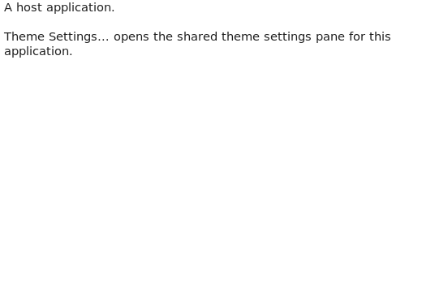 | 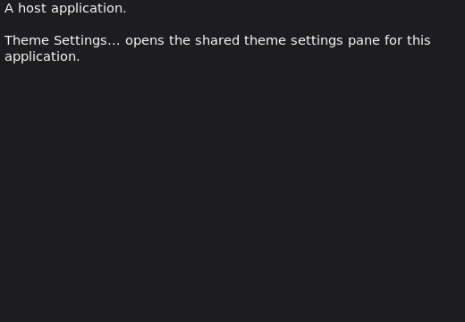 |
| 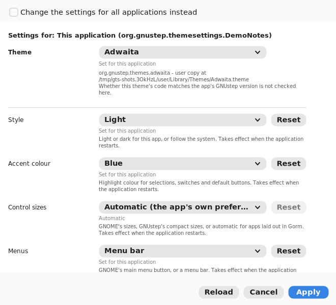 | 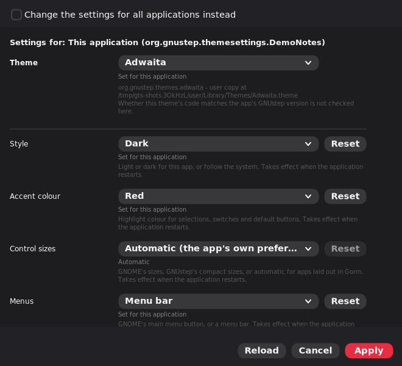 |

To show the accent colour, the pane captures stage a throwaway change, which
enables Apply, the default button that Adwaita draws in the accent colour.
That change is cancelled each time, and the run checks it was never saved.

**Restart needed, and the UI says so.** Right after Apply the same running
app is still light and blue, with "Saved. Restart the affected applications
to see every change." Both rows also say "Takes effect when the application
restarts".

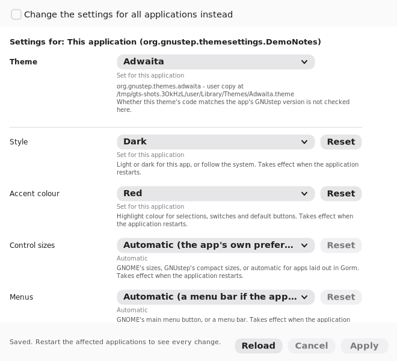

## Gumdrop (scenarios K and L at 5e76007; owner proofs later), 2026-11-11

The editor changed all five settings, and the read-back confirms all five
were saved: menu style menubar, interface font DejaVuSerif, font size 20,
corner radius 0, shadows NO. The theme loaded.

**Interface font and size: visible.** After relaunch, the editor pane's own
controls (pop-up menus, text fields, buttons, the checkbox) are drawn in
DejaVu Serif at 20 points instead of DejaVu Sans. Standard GNUstep cells use
the system font (`NSFont`/`NSFontSize`).

| Before (theme defaults) | After relaunch (DejaVuSerif, 20) |
|---|---|
| 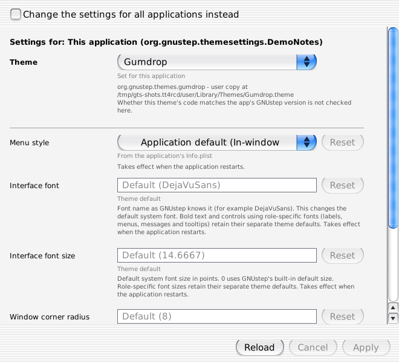 | 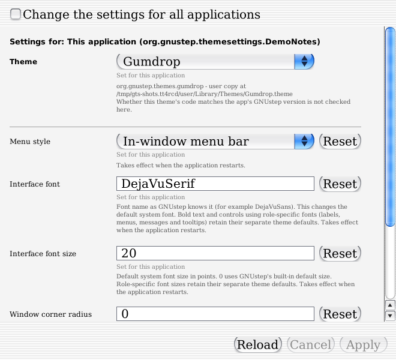 |

A correction: an earlier version of this page said these rows had no
visible effect. It looked only at DemoNotes' main window, whose text is an
`NSTextView`, and text views use the *user* font (`NSUserFont`), not the
system font.

**Control-content font (scenario L): no visible effect on standard
controls.** With a draft settings file that added `NSControlContentFont`
rows, setting it to DejaVuSerif 20 left the same pane unchanged after
relaunch. Standard cells don't ask for the control-content font, so such a
row would mislead.

| Before | After relaunch (NSControlContentFont DejaVuSerif, 20) |
|---|---|
| 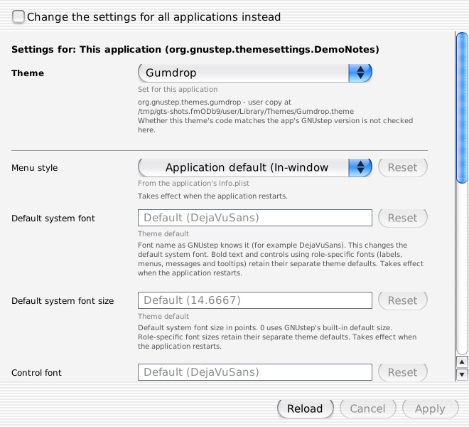 | 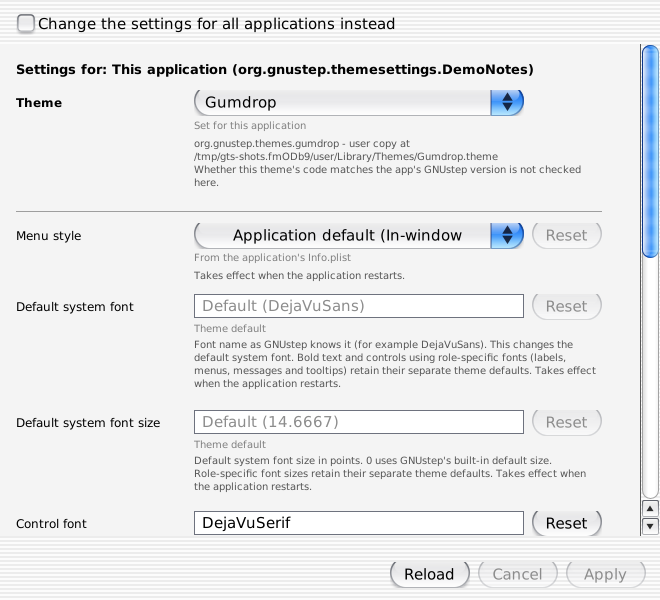 |

**Menu style, corner radius and shadows: visible (fun-themes, 2026-11-11).**
fun-themes ran the same editor-to-screen check on its own host, on GNOME
Shell `--x11` over a private Xvfb with the csd8 libs-back backend, taking
full-screen captures (1440x1000). Each setting was written by the
ThemeSettings editor (Apply) into a scratch GumdropDemo domain, read back
with `defaults read`, and the app relaunched. None of the three keys was
passed as a process argument. The backend switches were process arguments:
`-GSX11HandlesWindowDecorations NO`, `-GSBackHandlesWindowDecorations NO`
and the shadow backend alias.

| Setting | Change (others held fixed) | Observed |
|---|---|---|
| Window corner radius | 0 → 20 (shadows YES) | Square corners become rounded: desktop pixels in a 20x20 corner go from 0 to 94. |
| Window shadows | YES → NO (radius 0) | The shadow falloff disappears: samples just outside the frame return to the plain desktop colour, and the frame extents go from 30,30,24,36 to 0,0,0,0. |
| Menu style | primary → menubar | The title-bar menu button goes, and a 36-point in-window menu bar appears (frame height 760 → 796, same content). Both menus open and close with Escape. |

Sources: editor gnustep-themes 3a749f9, Gumdrop 75c8c8d, libs-back 8348401
(csd8). The captures (baseline-primary, radius-20, shadows-off, menubar,
and both menus open), read-backs and logs are in fun-themes' proof commit
c0001fb:
[report](https://github.com/danjboyd/gnustep-funthemes/blob/c0001fb8ad7473192aff6376e175b3c58744320c/Tests/Diagnostics/gumdrop-settings-proof-20261111.md),
[captures](https://github.com/danjboyd/gnustep-funthemes/tree/c0001fb8ad7473192aff6376e175b3c58744320c/Tests/Diagnostics/gumdrop-settings-proof-20261111).
That repository is private, so these links work only for its members. This applies to X11 with csd8, where GNUstep draws the
window frame. On a backend that leaves frames to the window manager,
corners and shadows have no effect, as the help text says.

**Control size (density, added at 5fd5fa6): visible on Linux (fun-themes,
2026-11-11).** The same editor-to-screen method was used. ThemeSettings
3a749f9 loaded Gumdrop's settings file at 5fd5fa6 and chose Regular, then
Compact, for a scratch GumdropDemo application domain. Apply saved each
choice and `defaults read` matched. A new app process then started with no
size or font arguments, and full-screen captures were taken.

| | Regular | Compact |
|---|---|---|
| Scale | 1 | 0.875 |
| Default system font size | 14.6667 | 12.8334 |
| Title bar height | 40 | 35 |
| Scroller width | 19 | 17 |

The captures differ visibly. Controls with app-authored fixed frames kept
their exact sizes, and the window shrank from 760 to 747 points high. Scope:
Linux, GNOME/X11 with csd8, 96 DPI, application domain only. No global-domain
or Windows proof is claimed. The captures, read-backs and results are in
fun-themes' proof commit cdb9c9d:
[report](https://github.com/danjboyd/gnustep-funthemes/blob/cdb9c9d01066be7c704a9ba3a7b4fc1733f57cae/Tests/Diagnostics/gumdrop-density-setting-proof-20261111.md),
[captures](https://github.com/danjboyd/gnustep-funthemes/tree/cdb9c9d01066be7c704a9ba3a7b4fc1733f57cae/Tests/Diagnostics/gumdrop-density-setting-proof-20261111)
(private repository, members only). Its settings file is at
[5fd5fa6](https://github.com/danjboyd/gnustep-funthemes/blob/5fd5fa64802a0325d713a4ec3201b437a4b4a5cd/Themes/Gumdrop/ThemeSettings.plist),
which `examples/Gumdrop.theme` now mirrors byte for byte.


## Adwaita follows GNOME by itself (scenario O), plugins-themes-Adwaita 510fa53, 2026-11-13

This checks whether the **Follow GNOME** switch needs a helper that copies
GNOME's settings into GNUstep defaults. It doesn't, at least on a normal
install.

The run was on a private Xvfb with a scratch GNUstep home. GNOME's settings
came from a private GSettings keyfile (`GSETTINGS_BACKEND=keyfile`,
`XDG_CONFIG_HOME` in the scratch root), never the real dconf database.
DemoNotes used the built Adwaita theme, with no colour scheme or accent
stored.

| Step | Result |
|---|---|
| Start: GNOME light, blue | light, blue (O1) |
| GNOME changed to dark, purple while DemoNotes was open | dark, purple **in the running app** (O2). Adwaita watches GNOME's settings through GIO. |
| Relaunch | dark, purple (O3) |
| Switch turned off in the pane, Apply | `force-dark` and `purple` stored (checked by read-back) |
| GNOME changed to light, green; relaunch | still dark, purple (O4): the stored values win |

| Before (O1) | GNOME changed, app still open (O2) |
|---|---|
| 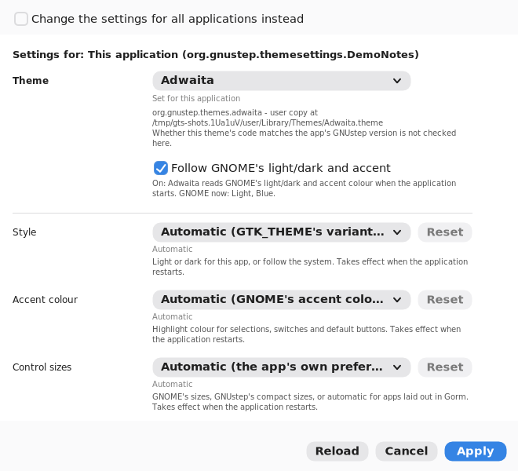 |  |

| Relaunched (O3) | Pinned, GNOME changed again (O4) |
|---|---|
| 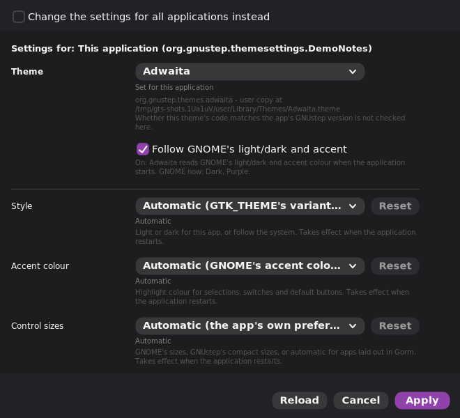 | 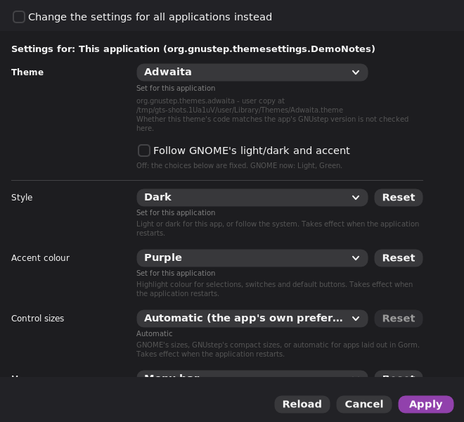 |

In O2 the note under the switch still says "GNOME now: Light, Blue". It was
read when the pane opened, and Reload refreshes it.

**Possible gap, not tested.** Adwaita reads GNOME through GIO. An AppImage
that bundles Adwaita would also need GIO's dconf module and GNOME's schemas
to reach the host's settings. Without them, GLib falls back to its in-memory
settings, and the app would stay light and blue. No such AppImage exists yet:
the Theme Settings AppImage bundles neither Adwaita nor GIO. Check this when
one is built.

To run it: build Adwaita with the clang toolchain, then:

```sh
GTS_MASTER_CONF=<toolchain>/etc/GNUstep/GNUstep.conf \
GTS_DEFAULTS_TOOL=<toolchain>/Local/Tools/defaults \
GTS_E2E_THEMES=<dir with the built Adwaita.theme> GTS_SHOTS_ONLY=O scripts/screenshots.sh <out>
```
