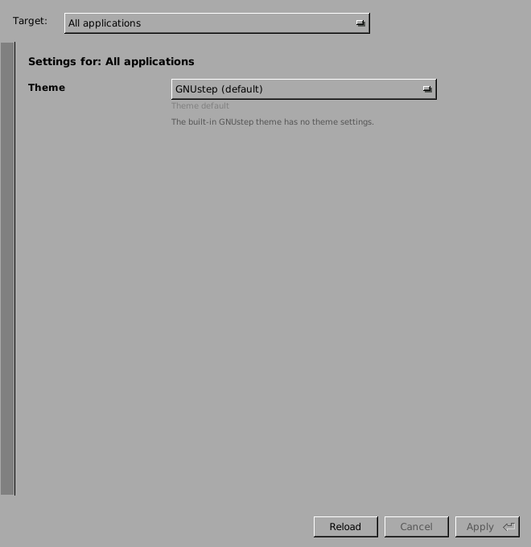
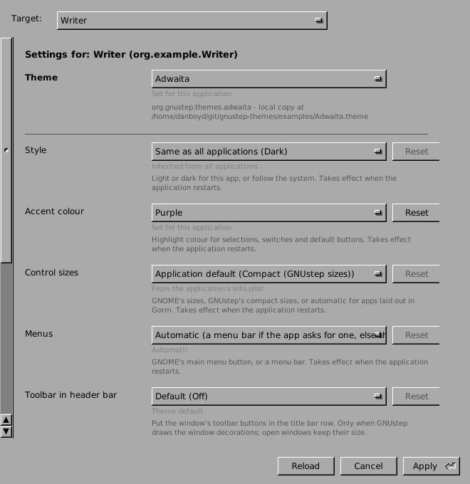
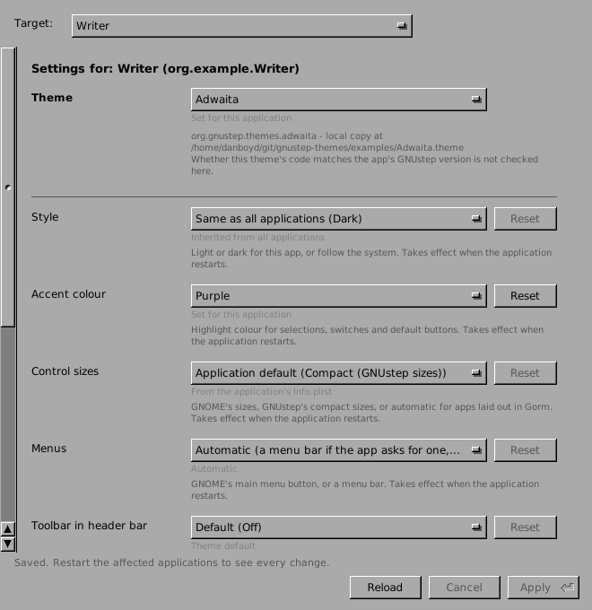
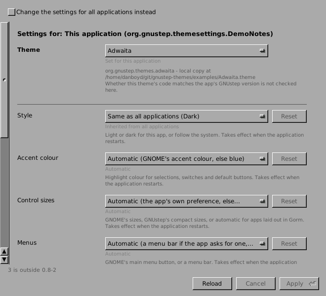
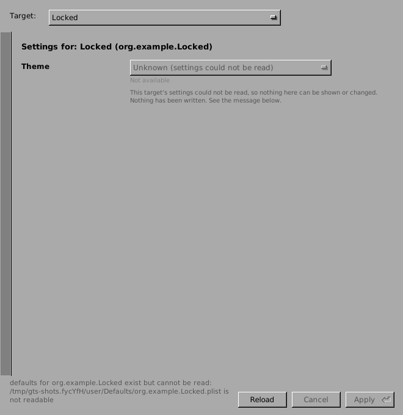
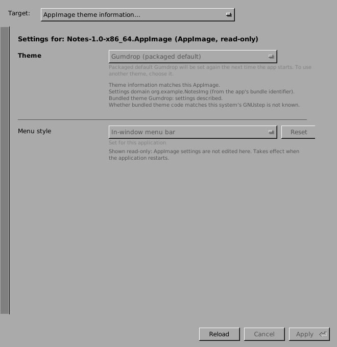

# Theme Settings: user guide

Theme Settings lets you choose a GNUstep theme and change that theme's
settings, for all your applications at once or for one application, without
editing defaults by hand. The screenshots below come from
`scripts/screenshots.sh`: they use the example themes in `examples/` and
scratch settings, never anyone's real ones.

There are two ways to reach the same editor:

* **The Theme Settings app** (`ThemeSettingsApp`), which edits settings for
  all applications or for any application you pick.
* **An application's own preferences**, for applications that embed the
  editor (`ThemeSettingsDemo` shows how). These edit that application's
  settings, with a checkbox to switch to all applications instead.

## Choosing what to change: the target

The **Target** menu at the top of the app picks whose settings you see:

* **All applications**: your global settings (GNUstep's `NSGlobalDomain`).
  Every application uses these unless it has its own value.
* **An application**: the applications the app finds in your standard
  Applications folders are listed by name. **Other application…** opens any
  other `.app`. A value set here applies to that application only.
* **AppImage theme information…**: shows what an AppImage package says
  about its theme. It's read-only; see "AppImages" below.



To open the app on a particular application from a terminal:

```sh
openapp ThemeSettings.app -GTSTargetApp /path/to/Some.app
```

## The theme

The **Theme** row picks the theme, for the current target. The lines under it
say where the current choice comes from, which copy of the theme is used
(and where it's installed), and anything unusual, for example a theme that
is selected but not installed. Whether a theme's code works with your GNUstep
version is never checked here.

## Settings

Below the theme come the settings the selected theme describes. A theme
that describes none says so. Each row has:

* **The control**: a menu of choices, or a text field for a name or number.
  The first menu item (for example "Automatic (…)" or "Default (Off)") means
  "no value of my own": it removes your value, so the application falls back
  to whatever applies next.
* **The state line** (small grey text) says where today's value comes from:

  | State | Meaning |
  |---|---|
  | Set for all applications / Set for this application | You (or someone) stored a value for this target. |
  | Inherited from all applications | Not set for this application; the global value applies. |
  | From the application's Info.plist | Not set anywhere; the application's own preference applies. |
  | Theme default | Not set anywhere; the theme's fixed default applies. |
  | Automatic | Not set anywhere; the theme works it out at run time (the menu item says how). |

* **When it takes effect**, at the end of the help text: "Takes effect when
  the application restarts", or "Applies to windows and panels opened after
  saving". Settings with neither note are applied by the theme while the
  application runs.
* **Reset** removes this target's value, like choosing the first menu item.



## Apply, Cancel, Reload

Changes are **staged** until you press **Apply** (or Return). **Cancel**
drops staged changes, and **Reload** re-reads the stored settings.

* Text typed in a field counts, even if you didn't press Tab first.
* Text that isn't valid (a number out of range, for example) is never saved.
  The field keeps what you typed, selected, and the message at the bottom
  says why. Leave the field, or press Reload, to get the stored value back.
* If another program changed the same setting since you opened it, Apply
  refuses and lists the settings that changed; press Reload and try again.
  Nothing is overwritten silently.
* After Apply the message at the bottom says what happened, for example
  "Saved. Restart the affected applications to see every change."




## When nothing can be changed

Sometimes the editor shows settings but greys everything out. The message
at the bottom says why:

* **The settings can't be read**, for example a damaged or unreadable
  settings file. Nothing is shown or written.

  

* **Windows (for now)**: settings are shown, read-only, with "this defaults
  backend is not supported for editing yet". Editing on Windows will come
  once writing there has been verified.
* **A theme asks for something this version doesn't understand**: its rows
  are shown read-only, with a note.

## Install and run the AppImage

Theme Settings is also built as a single-file AppImage for Linux (x86_64),
with its own GNUstep runtime. There is no tagged release yet. Each build is a
download from the manual `package-appimage` workflow on GitHub, and GitHub
deletes those downloads after a few days.

1. **Download.** Open the repository's **Actions** tab, then the latest
   successful **package-appimage** run. Download the artifact
   `theme-settings-appimage-packages` and unzip it. With the GitHub CLI:

   ```sh
   gh run download <run-id> -R danjboyd/gnustep-themes -n theme-settings-appimage-packages -D ThemeSettings-appimage
   ```

2. **Make it executable:**
   `chmod +x ThemeSettings-appimage/ThemeSettings-*-x86_64.AppImage`.
3. **Run it.** Double-click it or start it from a terminal. If your system has
   no FUSE, set `APPIMAGE_EXTRACT_AND_RUN=1` first.

**Trying it without touching your settings.** From a checkout of this
repository, `packaging/try-isolated.sh path/to/ThemeSettings-*.AppImage`
runs the AppImage with a throwaway GNUstep home:

- It confirms, before launching, that the AppImage's own `defaults` tool
  reads that throwaway home, and refuses to start otherwise.
- It compares checksums of your real defaults folder before and after the
  run, and reports any change as a failure.
- Your installed themes are still listed. Apply writes only into the
  throwaway folder, whose path is printed at the end.

Setting only `HOME` is not enough: GNUstep takes its home from
`GNUSTEP_HOME`, or from your account, and ignores `HOME`.

**What Apply writes, and where.** It writes your GNUstep defaults, the same
settings `defaults read` shows, normally in `~/GNUstep/Defaults`. There is no
separate settings file.

- For **All applications**: `NSGlobalDomain.plist` gets `GSTheme` (the theme)
  and the theme's own keys, for example `GnomeThemeAccentColor`.
- For **one application**: the same keys go into that application's own file,
  for example `org.example.Writer.plist`.
- Only the keys the theme lists in its `ThemeSettings.plist` are written,
  plus `GSTheme`. Other keys in those files are left as they were.

**Undoing a change:**

- In the editor, press the row's **Reset** (or choose its first menu item,
  "Default (…)" or "Automatic (…)"), then press Apply. That removes the key,
  so the theme's own default applies again.
- From a terminal: `defaults delete NSGlobalDomain GnomeThemeAccentColor`, or
  `defaults delete <application domain> <key>` for one application.
- To be able to undo everything at once, copy your settings first:
  `cp -a ~/GNUstep/Defaults ~/GNUstep/Defaults.before-theme-settings`.

**Which themes it lists.** The AppImage looks in the usual theme folders:
`~/GNUstep/Library/Themes`, `/usr/local/lib/GNUstep/Themes`,
`/usr/lib/GNUstep/Themes`, `/usr/GNUstep/Local/Library/Themes` and
`/usr/GNUstep/System/Library/Themes`. To use other folders, set
`GTS_HOST_THEME_ROOTS` to a colon-separated list. The editor reads only each
theme's `ThemeSettings.plist` and never loads theme code. The editor window
itself always uses the plain GNUstep look, whichever theme you choose.

**Known launcher issue.** The AppImage's launcher treats a command-line
option value that contains "/" but doesn't start with "/" as a relative path,
and prefixes the current folder to it. For example, `-Key text/plain` reaches
the app as `-Key $PWD/text/plain`. Normal use doesn't pass such options. A fix
is planned in gnustep-packager; until then, give such values as absolute
paths or avoid "/".

## AppImage theme information

An AppImage may come with a `.themes.json` file next to it, describing the
theme it uses. Choose **AppImage theme information…** and open that file to
see:

* which theme the package sets by default, and when it writes it;
* what this editor's own settings store holds for that application. An
  AppImage may keep its settings somewhere else, so these values are not
  confirmed as the AppImage's own.

This view never changes anything.



## For theme authors

To make your theme's settings appear here, add a `ThemeSettings.plist` to
the theme bundle: see the [README](../README.md) and
[schema-v1.md](schema-v1.md), and check it with
`scripts/validate-theme.sh`.
