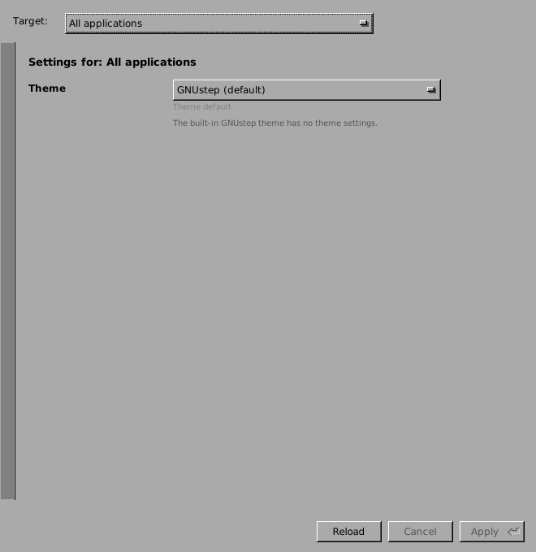
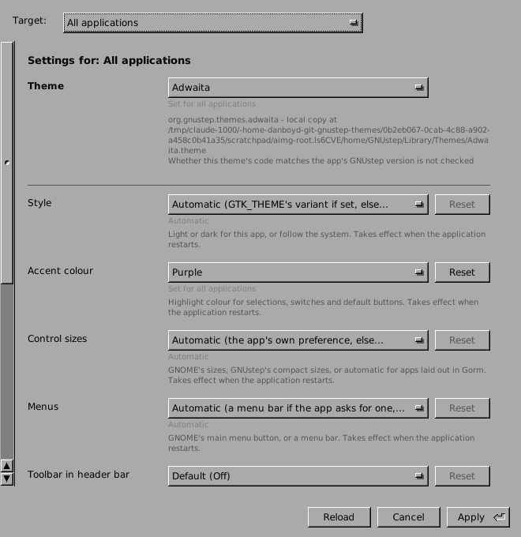
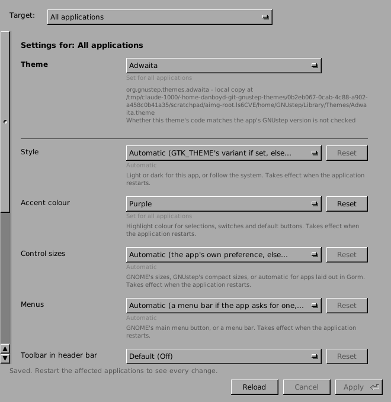
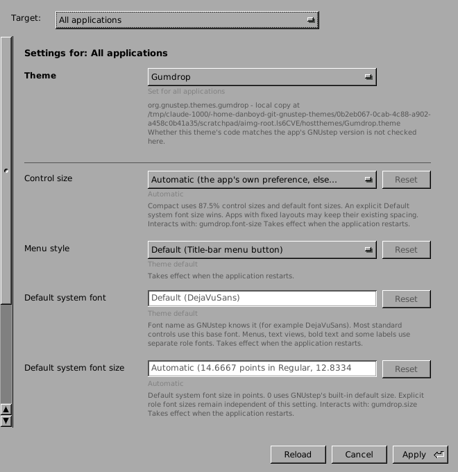

# Theme Settings AppImage

`package.manifest.json` describes the Theme Settings app for
[gnustep-packager](https://github.com/danjboyd/gnustep-packager), pinned at
9a8c784 in `.github/workflows/package-appimage.yml`. That workflow is
manual-only. It builds `ThemeSettings-<version>-x86_64.AppImage` as a GitHub
artifact; it never makes a release or a tag.

What the AppImage contains:

- the standalone editor, with its own GNUstep runtime (clang/libobjc2) and
  DejaVu fonts;
- the launch arguments `-GSTheme GNUstep`, so the editor itself always
  draws with the built-in theme, whatever theme you choose for other
  applications. It reads themes' `ThemeSettings.plist` files and never loads
  theme code.

How it finds and stores things:

- **Installed themes:** the launcher sets `GTS_HOST_THEME_ROOTS` (only if
  unset) to the usual host theme folders: `~/GNUstep/Library/Themes`,
  `/usr/local/lib/GNUstep/Themes`, `/usr/lib/GNUstep/Themes`,
  `/usr/GNUstep/Local/Library/Themes` and `/usr/GNUstep/System/Library/Themes`.
  Set it yourself to use other folders (colon-separated).
- **Settings:** the user's GNUstep defaults, `~/GNUstep/Defaults`. The
  launcher always uses the bundled `GNUstep.conf`, so to point it at another
  home (for a test) set `GNUSTEP_HOME`, not `GNUSTEP_CONFIG_FILE`.

## Test run (2026-11-13, package-appimage run 43507118802 at 7b71cc0)

`packaging/test-appimage.sh` runs a built AppImage on a private Xvfb display
(never :0, :1 or :120) with a scratch `GNUSTEP_HOME`, defaults and theme
folders. A read-only first launch must report a defaults root inside the
scratch folder before anything is written. Results:

- **New user:** with no `~/GNUstep/Defaults` yet, the editor opens without
  errors. (The first build showed "could not load defaults to read
  NSGlobalDomain" here; fixed in the store at 7b57b2d, and
  `scripts/fresh-root-check.sh` now checks it in CI.)
- **Installed themes:** Adwaita in the scratch home's `Library/Themes` and
  Gumdrop only in a separate folder named by `GTS_HOST_THEME_ROOTS` are both
  offered. Without that variable, Gumdrop isn't offered (control).
- **Saving:** choosing Adwaita with a purple accent for all applications and
  pressing Apply stored `GSTheme = Adwaita` and
  `GnomeThemeAccentColor = purple` in the scratch `NSGlobalDomain.plist`, with
  "Saved. Restart the affected applications to see every change."

| New home | Adwaita, purple staged | Applied | Gumdrop via `GTS_HOST_THEME_ROOTS` |
|---|---|---|---|
|  |  |  |  |

Known launcher issue (gnustep-packager, fix planned): the generated `AppRun`
treats an option value that contains "/" as a relative path. For example,
`-GTSScript "log; shot /tmp/x.png"` reaches the app as
`$PWD/log; shot /tmp/x.png`. The test script starts each script with a
throwaway `nop` step for that reason. Normal use is not affected.
